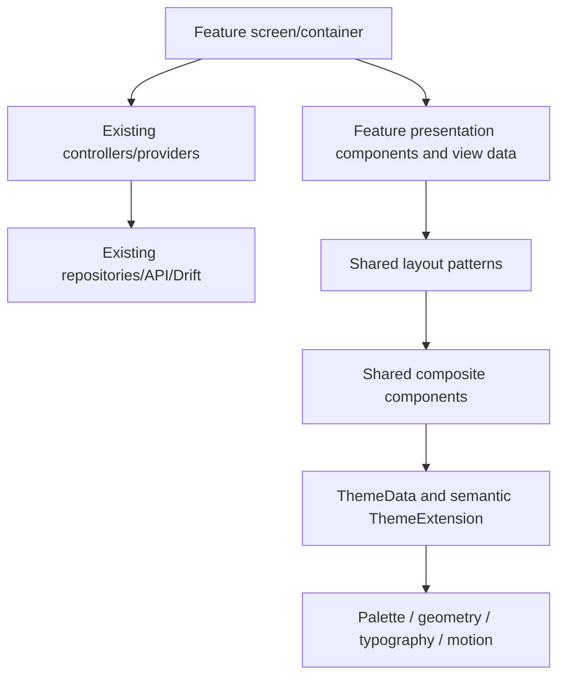

# ADR 001: Flutter redesign foundation

Status: implementation contract for #377; visual composition remains subject
 to #375/#376 review. Concept: Soft Grid. No feature issue is superseded.

## Dependency direction and ownership

| Layer/path under `app/lib/src` | Owns | Input/output contract |
| --- | --- | --- |
| `core/design_system/foundations` | Named palette IDs, geometry, durations | Pure values; no feature imports |
| `core/design_system/theme` | Semantic roles, ThemeExtension, Material themes | Palette + brightness → ThemeData |
| `core/design_system/components` | Busy action, empty/problem/loading, headers | Localized strings, typed visual state, callbacks/slots |
| `core/design_system/patterns` | Form sections, metadata, photo layout, timeline, action surface | View data + child slots; no authorization decisions |
| `features/listings/presentation/components` | ListingCard/Header and editor composition | Listing view data + domain-approved callbacks |
| `features/*/presentation/view_data` | Display-only data for the owning feature | Explicit nullable/redacted fields; unknown status fallback |
| `features/*/presentation/*screen*` | Routing, provider subscriptions, orchestration binding | Map application state into data/callbacks |
| `features/*/application`, `domain`, `data` | Loading, permissions, transitions, cache/queue | Existing Riverpod, API, idempotency and Drift contracts |
| `catalog` (separate entry point) | Synthetic fixtures and state demonstrations | No ProviderScope, session, backend or production data |
| `core/router` | Stable locations and shell branch registry | go_router; gates remain outside visual primitives |

Shared code must not import features, generated API models, providers,
repositories, database, auth or router. Theme values come through
`Theme.of(context)` and its extension, never copied hex literals. A
feature's view data may use enums defined in presentation, not a second
business state machine. Unknown server values map to a localized neutral
status and no inferred action. Optional personal fields stay absent; no
placeholder invented identity or trust score.

## Component contracts

Prefer configuring native Material controls with ThemeData. Keep native
focus, hover, pressed, keyboard, autofill, validation and semantics. Do not
wrap every button, field, chip, segmented control or icon. Introduce a
composite only for repeated behavior or composition. Shared inputs use
immutable named parameters, required localized labels and explicit slots.
Actions receive `VoidCallback?`; absence means unavailable, with a visible
reason supplied by the container where needed. Busy is an explicit action
state and prevents a second invocation. It is not server success.

Separate full-page initial loading/empty/failure from retained content with
inline refresh/error/offline/conflict notices. Retry is an explicit callback.
Never clear cached content merely to animate a request. Editors use sections
(photo, audience, description) with feature-owned fields and a bottom action
slot, not a `kind` switch plus dozens of boolean flags. Stable keys identify
items and stateful sections.

Extract a component when two families need the same contract, or document
both named future consumers in the pattern guide. Start with leaf extraction
and widget behavior tests, then composition, then migrate one screen family
per PR. Preserve provider scope, disposal, focus, scroll, form draft and
request identity. Do not split files solely to satisfy a line-count target.

## Tool decisions

The reproducible package spike is `app/tool/ui_compat`; it has its own lockfile
and does not add catalog dependencies to the shipping app. Environment:
Flutter 3.50.0 (`ab2912035e`), Dart 3.14.0, material_ui 1.11.0, Linux.

| Candidate | Problem/license | Decision |
| --- | --- | --- |
| material_ui 1.11.0 | Current official Material UI; BSD-3-Clause | Retain; configure ThemeData, no additional UI kit |
| Widgetbook 3.25.0 | Fixture navigation, knobs and tooling; MIT | Adopt for local catalog **with explicit material_ui appBuilder**; its shell and MaterialThemeAddon still use legacy Flutter Material types. Do not pass material_ui ThemeData to that addon; use a generic ThemeAddon with our Theme builder or an in-preview settings harness |
| animations 3.0.0 | Maintained fade-through/shared-axis primitives; BSD-3-Clause | Adopt one package in #382, only through central primitives; uses material_ui. No second animation framework |
| Manrope | Offline Latin/Cyrillic typography; SIL OFL 1.1 | Bundle font and license in #379, use stable weights 400/500/600/700; no runtime font service |
| Material Icons | Existing bundled icon vocabulary; Apache 2.0 | Retain with semantic labels/tooltips, no parallel icon family |
| flutter_test | Behavior/semantics/goldens; SDK BSD | Adopt local goldens with bundled font loading, pinned SDK/Linux rendering; no cloud service |

Widgetbook's legacy shell is tooling-only. Its automatic Material theme addon
is not type-compatible with material_ui. The spike mounts an actual
material_ui button inside its selected use case and an animations transition.
Test both the final control and theme inheritance, not merely package solve.
Run from `app/tool/ui_compat`: `flutter pub get`, `flutter test`.
Revisit the adapter when Widgetbook migrates to material_ui.

## Visual and accessibility verification

Use deterministic fixtures, fixed surface size, explicit locale, bundled
fonts and no network/time/randomness. Golden representative controls and
compositions, not every combinatorial screen. Inspect the first baseline;
subsequent diffs require deliberate visual review, never mass refresh to make
CI pass. Cover all eight color schemes numerically for text >=4.5:1 and
control/focus boundaries >=3:1; test long RU/EN text, narrow width, 2x text,
keyboard focus and disabled/busy/retry. A golden does not prove TalkBack or
performance. Report runtime/manual evidence separately.

## Navigation and motion constraints

Keep Riverpod/go_router/Drift, API, request idempotency, cache/queue,
privacy/roles, consent and update/auth/profile guards. No UI-calculated
rating, payment provider or duplicated lifecycle. Preserve `/listings/:id`,
interactions/QR, `/offers/:listingId`, `/chats/:chatId?message=...` and existing
account routes. Four stateful branches; Create is a sheet action, not a fifth
destination. Fullscreen editors/scanners can use the root navigator.

Motion uses central durations/curves, respects MediaQuery.disableAnimations,
does not await animations before applying server state and stops tickers in
inactive branches. Use platform page transitions for Back gestures. Reduced
motion renders final content without translation, scale or decoration.

## Sources checked on 2026-11-16

- [Widgetbook package and MIT license](https://pub.dev/packages/widgetbook/versions/3.25.0)
- [Widgetbook addons](https://docs.widgetbook.io/addons/overview)
- [animations package and BSD license](https://pub.dev/packages/animations/versions/3.0.0)
- [ThemeExtension contract](https://api.flutter.dev/flutter/material/ThemeExtension-class.html)
- [Bundled fonts](https://docs.flutter.dev/cookbook/design/fonts)
- Installed package sources: Widgetbook `widgetbook.dart`,
  `material_theme_addon.dart`; animations `fade_through_transition.dart`;
  material_ui `pubspec.yaml`; Flutter `material.dart` deprecation annotation.
