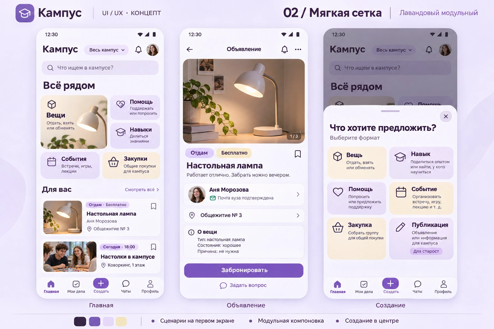
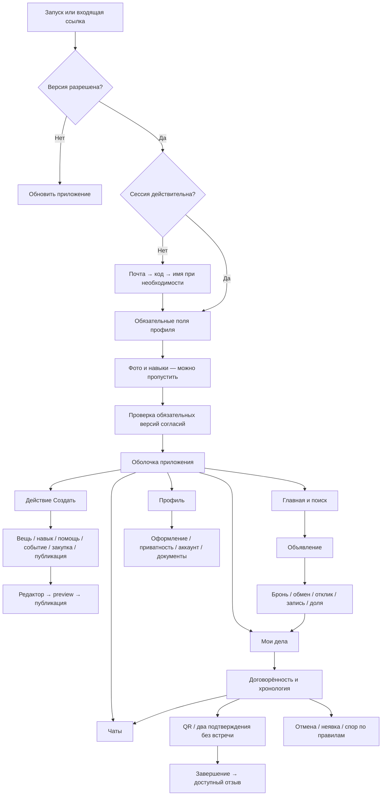

# Полный редизайн: «Мягкая сетка»

Главный эпик: [#373](https://github.com/Roman-Andr/campus-platform/issues/373).
Реестр: [#375](https://github.com/Roman-Andr/campus-platform/issues/375).
Дата снимка: 2026-11-16. Исходная ревизия:
`2cb85e6681bd9debf839455d95c47af2d4de0389`.

Это первая UX-проработка и карта покрытия. Композиции и ограничения
предлагаются для проверки. Сгенерированные изображения служат визуальными
черновиками: они не подтверждают реализацию, точные размеры, контраст,
корректность всех текстов или поведение API.

## Принятый визуальный язык

Пользователь выбрал концепт №2: модульная главная, спокойные поверхности,
крупные понятные входы в сценарии, аккуратная типографика, нижняя навигация
и создание в центре. Палитры выбираются независимо от режима яркости.



В референсе есть формулировки и детали, требующие уточнения. Например,
создание запроса помощи должно следовать существующему API: не обещать
отдельную публикацию «предлагаю помощь», если такая функция отсутствует.
Примерные даты, имена, рейтинги и фото в макетах не являются данными сервиса.

## Что покрыто

- [code-inventory.json](code-inventory.json): 42 публичных класса экранов,
  исходные файлы и строки на указанной ревизии.
- [screen-catalog.json](screen-catalog.json): 42 экранных семейства с входом,
  композицией, главным/вторичными действиями, особыми состояниями, правами,
  компонентами, адаптивностью и ответственной задачей.
- [screens.md](screens.md): читаемая версия реестра.
- [boards.md](boards.md): 26 визуальных листов / 78 экранных представлений.
- [review-notes.md](review-notes.md): проверка и ограничения визуальных черновиков.
- [boards.md](boards.md): 26 визуальных листов / 78 экранных представлений.
- [review-notes.md](review-notes.md): проверка и ограничения визуальных черновиков.
- [issue-tree.md](issue-tree.md): шесть направлений и 28 задач-листьев.
- [future-and-gaps.md](future-and-gaps.md): ещё не завершённые клиентские
  возможности Среза 1 и точки расширения последующих срезов.
- [verify_inventory.py](verify_inventory.py): сверка покрытия с реальным
  Flutter-кодом; запускается из любого каталога.

Семейство не равно отдельному route. Например, ListingScreen имеет восемь
предметных вариантов; EventAttendanceScreen выбирает organizer/participant
представление; ProfileFormScreen используется и при onboarding, и для
редактирования. Существующие sheet, dialogs, photo/error/retry состояния
учтены в соответствующих семействах и общей матрице ниже.

## Структура навигации



Это пользовательская последовательность, а не инструкция заменить
существующие guards новым безусловным redirect. В реализации сохраняются
приоритет update-required, действующий порядок auth/profile/consent,
возврат к допустимой входящей ссылке и защита от redirect loops.

### Контракт оболочки

Четыре независимых destination: Главная, Мои дела, Чаты, Профиль.
Центральное «Создать» — кнопка открытия sheet; она не получает отдельный
выбранный navigation state. На широком контейнере те же destination
становятся rail/sidebar. Состояние поисков, прокрутки и вложенных маршрутов
сохраняется в каждой ветке. Полноэкранные редакторы, сканер и диалог могут
иметь локальную навигацию поверх оболочки.

Внешние ссылки `/listings/:id`, вложенные interactions/QR,
`/offers/:listingId`, `/chats/:chatId?message=...` и auth/settings/profile
маршруты сохраняются или получают явные совместимые redirects.

## Общая матрица состояний

| Слой | Обязательные варианты |
| --- | --- |
| Данные | first load; loaded; empty; cached+refresh; partial error; retry |
| Список | pagination; end; ошибка следующей страницы; восстановление scroll |
| Изменение | pristine; dirty; validation; submitting; server-confirmed; conflict; error |
| Сеть | online; offline cache; действие online-only; queued; reconnect |
| Фото | empty; local; uploading; processing; ready; failed; retry/remove |
| Доступ | student; employee; alumni/former employee; scoped headman; author; participant; visitor |
| Сроки | pending; active offer; expired; overdue return; отменено/скрыто |
| Устройство | compact/medium/expanded constraints; landscape; keyboard; mouse/focus |
| Доступность | RU/EN; крупный текст; screen reader; reduced motion; light/dark |

Матрица применяется по смыслу. Например, QR имеет queued/server-rejected,
но у read-only документа нет вымышленной брони; форма не показывает
«успешно», пока изменение не подтверждено сервером.

### Восемь вариантов объявления

| Вариант | Посетитель | Автор/участник | Существенное различие |
| --- | --- | --- | --- |
| Отдам | Забронировать | Принять/отклонить; передать | Принятая бронь и очередь |
| Обменяю | Предложить обмен | Выбрать предложение | Не общая кнопка брони |
| Одолжу | Забронировать | Выдать → вернуть | Два QR-этапа и срок возврата |
| Навык | Предложить занятие | Согласовать слоты | Объявление остаётся постоянным |
| Помощь | Откликнуться | Выбрать исполнителя | Один выбранный исполнитель и срок |
| Событие | Записаться/очередь | Посещение/код организатора | Ёмкость и регистрация |
| Закупка | Выбрать долю | Учёт оплаты/выдачи | Платят организатору напрямую |
| Публикация | Читать/сохранить | Изменить в пределах роли | Область и срок закрепления |

Недоступность действия поясняется конкретной причиной: роль, аудитория,
срок, состояние объекта, сеть или уже принятый участник. Нельзя заменять
это безымянной disabled-кнопкой или копировать право из макета на сервер.

## Предварительные архитектурные ограничения

Окончательное решение по структуре и пакетам оформляется в #377.
Следующие границы нужны уже для проектирования переиспользования:

```text
core/design_system/
  foundations/       palette, semantic colors, spacing, radii, motion
  theme/             ThemeData, ThemeExtension, typography, component themes
  components/        действительно общие составные UI-элементы
  patterns/          повторяемая композиция без бизнес-логики
features/<feature>/
  presentation/
    screens/         route/container: providers, навигация, callbacks
    components/      предметные карточки и формы
    view_data/       чистое представление сложных данных при необходимости
  application/       загрузка, команды, согласование состояния
  domain/, data/     существующие правила и доступ к данным
```

- Базовый компонент получает типизированные данные/callbacks и не читает
  API, базу, auth или конкретный feature provider.
- Предметный ListingCard/Composer/AttendanceRow живёт у своей feature;
  foundations не импортируют features.
- Общие секции формы переиспользуются композицией. Разные схемы payload
  не сливаются в одну форму с десятками `bool` и неявными ветками `kind`.
- Настройка стандартного контрола через ThemeData предпочтительнее
  обёртки, которая лишь повторяет его API.
- В UI нет локального копирования hex, произвольных отступов и
  переопределения семантических цветов статуса каждой палитрой.
- Riverpod, go_router, Drift, очередь сообщений, idempotency и доменные
  переходы сохраняются. Отдельная ViewModel/модель добавляется там, где
  действительно упрощает экран, а не ради обязательного слоя на каждый Text.

### Пакеты: кандидаты, а не установленные зависимости

| Инструмент | Предлагаемое применение | Условие включения |
| --- | --- | --- |
| Имеющийся material_ui | Семантика, focus, базовые контролы, theme | Сохранить текущую совместимость |
| Flutter ThemeExtension | Дополнительные семантические токены и interpolation | Явные copyWith/lerp и тест темы |
| Widgetbook | Изолированный каталог компонентов/состояний | Spike на Flutter 3.50+/material_ui; dev entry point |
| Flutter animations | Ограниченный набор переходов контейнера/оси/fade | Spike и единый motion-контракт |
| flutter_test golden API | Детерминированные визуальные эталоны | Локальные шрифты, фиксированные данные/SDK |
| Имеющиеся фото/QR-пакеты | Сохранить готовую обработку и lifecycle | Не дублировать библиотеки |

Платные облачные сервисы и дополнительные UI-kit не требуются.
Совместимость кандидатов ещё не подтверждена запуском проекта: этот
документ не заявляет, что `pub get`, сборка или UI-тесты уже выполнялись.

## Темы и движение

Палитра: lavender / sage / sky / peach. Режим: system / light / dark.
Настройки независимы, сохраняются в текущем key/value Preferences и имеют
безопасный default для старых/неизвестных значений. Один ColorScheme seed
недостаточен как полный контракт поверхностей, состояний и контрастов.

Предлагаемые motion-токены для проверки на реальном устройстве:

| Событие | Предварительный диапазон | Reduced motion |
| --- | --- | --- |
| Нажатие/выбор | 100–150 мс | Мгновенное состояние |
| Смена локального содержимого | 150–200 мс | Без сдвига/scale |
| Открытие sheet/переход | 200–300 мс | Короткое затухание или мгновенно |
| Смена темы | около 200 мс | Мгновенно |
| Loading | Только необходимый индикатор | Без декоративной пульсации |

Это проектные значения для проверки, не измеренная производительность.
Состояние сервера меняется независимо от окончания анимации. Offscreen
tickers останавливаются; контроллеры освобождаются; scroll и Back
сохраняют платформенное поведение. Нельзя выбирать preserve для
декоративной бесконечной анимации вместо обработки reduced motion.

## Контроль качества

В каждом листе дерева проверяются изменённые пользовательские маршруты,
существенные состояния и визуальные эталоны. Итоговая #407 повторно
сверяет актуальный код с реестром, поскольку за время работ новые экраны
могут появиться. Проверки тем, анимации и доступности выполняются в runtime;
картинка не является доказательством их прохождения.

Команда проверки текущего снимка:

```sh
python docs/design/redesign-v2/verify_inventory.py
```

## Источники

- Локальные: `CLAUDE.md`, `docs/vision.md`, `docs/features-prioritized.md`,
  `docs/paperwork/ТЗ/sections/05-requirements.typ`, Flutter router/theme/settings
  и presentation-код на указанной ревизии.
- [Flutter: architecture recommendations](https://docs.flutter.dev/app-architecture/recommendations)
  — разделение UI и данных и распределение ответственности.
- [Flutter: ThemeExtension](https://api.flutter.dev/flutter/material/ThemeExtension-class.html)
  — расширение ThemeData и interpolation.
- [Widgetbook](https://pub.dev/packages/widgetbook)
  — каталог изолированных компонентов и состояний.
- [Flutter animations](https://pub.dev/packages/animations)
  — поддерживаемые готовые переходы; версия проверяется spike-задачей.
- [AnimationBehavior](https://api.flutter.dev/flutter/animation/AnimationBehavior.html)
  — disableAnimations и поведение контроллеров.
- [Adaptive Flutter](https://docs.flutter.dev/ui/adaptive-responsive/general)
  — адаптация по constraints доступного пространства.
- [Flutter golden API](https://api.flutter.dev/flutter/flutter_test/matchesGoldenFile.html)
  — визуальные эталоны и различия шрифтов/среды.
